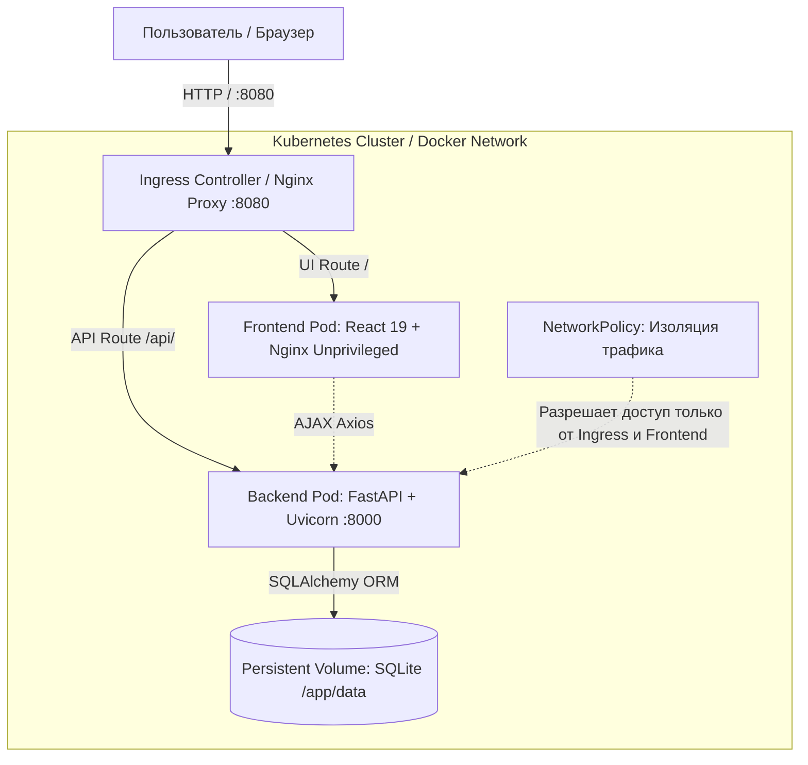
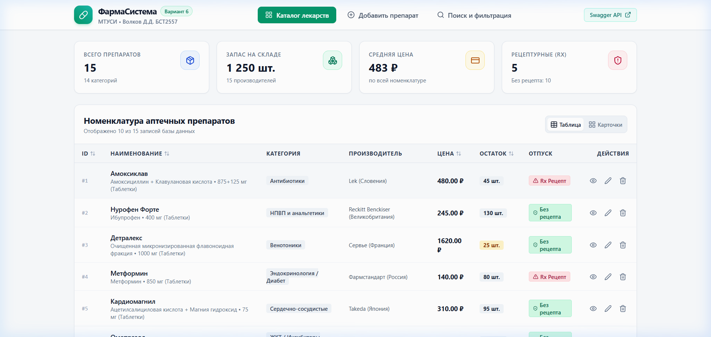
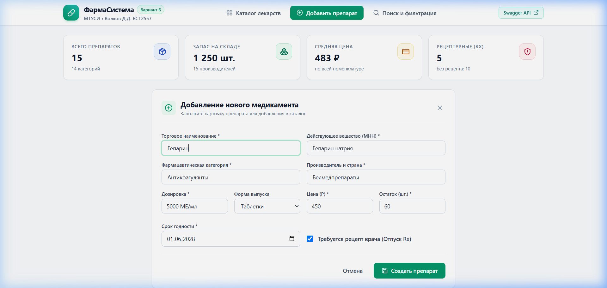
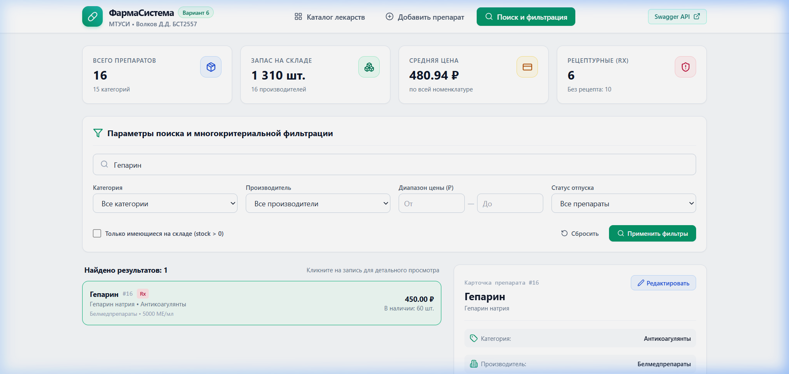
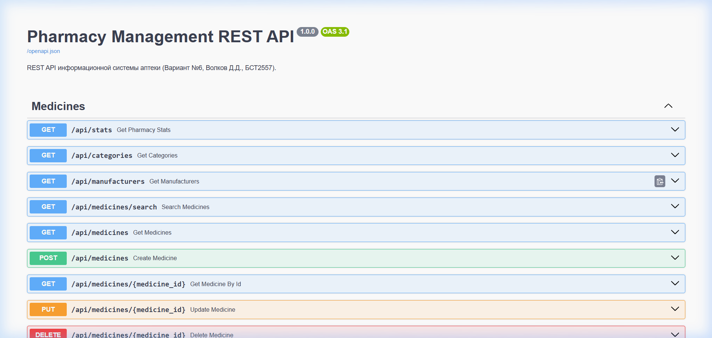

# 🏥 PharmaSystem DevSecOps — Информационная система аптечного учёта и каталога

[](https://github.com/LoveBitterMuffin/pharmacy-devsecops-fullstack/actions)
[](https://github.com/PyCQA/bandit)
[](https://pypi.org/project/pip-audit/)
[](https://docs.npmjs.com/cli/commands/npm-audit)
[](https://www.docker.com/)
[](https://kubernetes.io/docs/concepts/security/pod-security-standards/)
[](https://fastapi.tiangolo.com/)
[](https://react.dev/)
[](https://tailwindcss.com/)

> **Production-grade DevSecOps Fullstack Решение:** Комплексная клиент-серверная система аптечного учёта с реализацией лучших индустриальных практик безопасной разработки (Shift-Left Security), контейнеризацией в Docker, кластерными манифестами Kubernetes (PSS Restricted) и непрерывной интеграцией в GitHub Actions.

---

## 📑 Содержание
- [Архитектура системы](#-архитектура-системы)
- [Практики DevSecOps и безопасность](#-практики-devsecops-и-безопасность)
- [Функциональные возможности](#-функциональные-возможности)
- [Технологический стек](#-технологический-стек)
- [Варианты развертывания](#-варианты-развертывания)
  - [1. Локальный запуск (быстрый старт)](#1-локальный-запуск-быстрый-старт)
  - [2. Запуск в Docker Compose](#2-запуск-в-docker-compose-production)
  - [3. Оркестрация в Kubernetes (K8s)](#3-оркестрация-в-kubernetes-k8s)
- [CI/CD Пайплайн (GitHub Actions)](#-cicd-пайплайн-github-actions)
- [Тестирование и спецификация API](#-тестирование-и-спецификация-api)
- [Скриншоты интерфейса](#-скриншоты-интерфейса)
- [Автор](#-автор)

---

## 🏛️ Архитектура системы

Система построена по принципу слабой связанности (Decoupled SPA + REST API):



---

## 🛡️ Практики DevSecOps и безопасность

Проект спроектирован с упором на парадигму **Security by Design**:

1. **SCA (Software Composition Analysis)**:
   * **Frontend**: Зависимости зафиксированы с переопределениями безопасности (`overrides`), аудит `npm audit` подтверждает **0 vulnerabilities**.
   * **Backend**: Проверка через `pip-audit` подтверждает отсутствие уязвимостей в дереве зависимостей Python.
2. **SAST (Static Application Security Testing)**:
   * Код бэкенда сканируется анализатором безопасности **Bandit** (`bandit -r app -ll`). Все запросы к данным параметризованы через ORM SQLAlchemy 2.0 (защита от SQL Injection).
3. **Безопасность контейнеров (Container Hardening)**:
   * **Multi-stage сборка**: В итоговые runtime-образы не попадают компиляторы и сборочный инструментарий.
   * **Non-Root Execution**: 
     * Backend выполняется под непривилегированным пользователем `appuser` (UID: 10001).
     * Frontend выполняется под непривилегированным пользователем `nginx` (UID: 101, `nginxinc/nginx-unprivileged:1.27-alpine`).
   * Встроенные `HEALTHCHECK` в Dockerfile для автоматического контроля живучести сервисов.
4. **Безопасность Kubernetes (Pod Security Standards)**:
   * Namespace `pharmacy-devsecops` помечен лейблами профиля **Restricted**.
   * Все поды запускаются с флагами: `allowPrivilegeEscalation: false`, `readOnlyRootFilesystem: true`, `capabilities: { drop: ["ALL"] }`.
   * **NetworkPolicy**: Межсервисный брандмауэр блокирует любой несанкционированный входящий трафик к бэкенду.
5. **Защитные HTTP-заголовки (Security Headers)**:
   * `X-Content-Type-Options: nosniff`
   * `X-Frame-Options: DENY`
   * `Content-Security-Policy (CSP)`
   * `Referrer-Policy: strict-origin-when-cross-origin`

---

## 🚀 Функциональные возможности

* **Каталог медикаментов**: Табличный и карточный вид отображения, сортировка по наименованию, цене, остатку, сроку годности, серверная пагинация.
* **Аналитическая сводка склада (KPI)**: Виджеты общего количества позиций, суммарного остатка на складе, средней стоимости и количества рецептурных препаратов.
* **Управление номенклатурой (CRUD)**: Добавление новых препаратов с валидацией (цена > 0, остаток >= 0, непустые поля) и редактирование существующих.
* **Поиск и фильтрация**: Полнотекстовый поиск по торговому наименованию и действующему веществу (МНН), фильтр диапазона цен, выбор категорий и производителей, фильтр рецептурности и наличия.
* **Детальная карточка лекарства**: Подробная фармакологическая информация с автоматическим расчётом складской стоимости партии.

---

## 🛠️ Технологический стек

| Слой | Технологии |
|---|---|
| **Backend** | Python 3.12 / 3.14, FastAPI, SQLAlchemy 2.0, Pydantic v2, SQLite, Uvicorn, Pytest, HTTPX |
| **Frontend** | React 18/19, Vite, Tailwind CSS, Lucide React, Axios |
| **DevSecOps & CI/CD** | GitHub Actions, Bandit, Pip-audit, Npm audit, Aqua Security Trivy, Kubeconform |
| **Контейнеризация** | Docker (Multi-stage), Docker Compose, Nginx Unprivileged |
| **Оркестрация** | Kubernetes (K8s), Kustomize, Ingress Nginx, HPA, NetworkPolicy |

---

## 📦 Варианты развертывания

### 1. Локальный запуск (быстрый старт)
Для запуска бэкенда и фронтенда одной командой:
```bash
python start_all.py
```
* **Frontend**: [http://localhost:5173](http://localhost:5173)
* **Backend API**: [http://127.0.0.1:8000](http://127.0.0.1:8000)
* **Интерактивная документация Swagger**: [http://127.0.0.1:8000/docs](http://127.0.0.1:8000/docs)

---

### 2. Запуск в Docker Compose (Production)
```bash
# Сборка и запуск контейнеров в фоновом режиме
docker compose up --build -d

# Просмотр статуса контейнеров и логов
docker compose ps
docker compose logs -f
```
Приложение доступно:
* **Web UI**: [http://localhost:8080](http://localhost:8080)
* **Backend API**: [http://localhost:8000](http://localhost:8000)

Для остановки:
```bash
docker compose down
```

---

### 3. Оркестрация в Kubernetes (K8s)
Манифесты организованы через Kustomize и находятся в папке `k8s/`:
```bash
# 1. Применение всех манифестов одной командой
kubectl apply -k k8s/

# 2. Проверка статуса подов, сервисов и HPA
kubectl get pods,svc,hpa,ingress -n pharmacy-devsecops

# 3. Проброс порта для локальной проверки (если нет Ingress-контроллера)
kubectl port-forward svc/pharmacy-frontend 8080:8080 -n pharmacy-devsecops
```

---

## 🔄 CI/CD Пайплайн (GitHub Actions)

Пайплайн `.github/workflows/devsecops-pipeline.yml` автоматически запускается на каждый `push` и `pull_request` в ветки `main`/`master`:

1. **🧪 Quality & Tests**:
   * Запуск набора тестов Pytest (8/8 успешно).
   * Компиляция статического фронтенд-бандла (`npm run build`).
2. **🛡️ SAST & SCA Security Audits**:
   * Анализ уязвимостей исходного кода с помощью **Bandit**.
   * Проверка открытых зависимостей через **pip-audit** и **npm audit**.
3. **🐳 Docker Build & Trivy Scan**:
   * Сборка Docker-образов для фронтенда и бэкенда.
   * Проверка образов сканером безопасности **Aqua Security Trivy** на известные CVE базовых пакетов.
4. **☸️ Kubernetes Manifests Validation**:
   * Тестирование сборки Kustomize-манифестов без ошибок синтаксиса.

---

## 🧪 Тестирование и спецификация API

### Запуск тестов бэкенда:
```bash
cd backend
pytest tests/ -v
```

### Реализованные эндпоинты REST API:
| Метод | Эндпоинт | Назначение |
|---|---|---|
| `GET` | `/api/medicines` | Каталог с фильтрацией (цены, производитель, категория), пагинацией и сортировкой |
| `GET` | `/api/medicines/{id}` | Полная информация по конкретному препарату |
| `POST` | `/api/medicines` | Регистрация нового лекарства (201 Created) |
| `PUT` | `/api/medicines/{id}` | Обновление информации о препарате |
| `DELETE` | `/api/medicines/{id}` | Удаление препарата из базы |
| `GET` | `/api/medicines/search` | Полнотекстовый поиск по наименованию и действующему веществу |
| `GET` | `/api/stats` | Агрегированная статистика: остатки, средняя цена, Rx-соотношение |
| `GET` | `/api/categories` | Список всех категорий номенклатуры |
| `GET` | `/api/manufacturers` | Список производителей в базе |

---

## 🖼️ Скриншоты интерфейса

| Экран 1: Каталог и аналитика склада | Экран 2: Форма добавления / редактирования |
|---|---|
|  |  |

| Экран 3: Фильтрация, поиск и детали | Интерактивный Swagger UI |
|---|---|
|  |  |

---

## 👤 Автор

* **Разработчик:** Дмитрий Волков ([LoveBitterMuffin](https://github.com/LoveBitterMuffin))  
* **Специализация:** DevSecOps / Full-Stack Engineering  
* **Стек:** Python (FastAPI), React, Docker, Kubernetes, CI/CD  
* **Лицензия:** MIT
